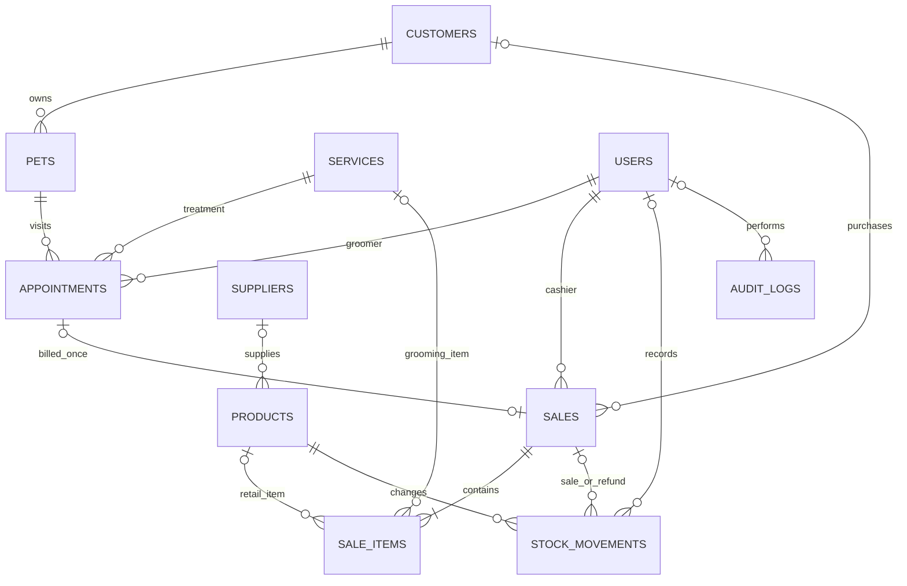

# Architecture & customization

## Stack and structure

Laravel 12 with PHP 8.2+, Blade templates, MySQL 8, and small static CSS/JS assets. No frontend build pipeline or SPA hydration. Requests render complete pages; browser JavaScript is limited to POS preview/search, menu controls, confirmations and printing. Data remains in MySQL, not localStorage.

```text
app/Http/Controllers/   HTTP orchestration, validation, queries
app/Http/Middleware/    Role checks, assignment access, security headers
app/Models/User.php    Authentication, password hashing, role/active state
app/Services/          Booking and checkout/refund transaction rules
app/Support/           Role matrix, catalog metadata, business settings, money/audit helpers
database/migrations/   Versioned schema, indexes, foreign keys
database/seeders/       Empty production seeder + explicit local demo seeder
resources/views/       Layout, modules, reusable components, friendly error pages
public/assets/         CSS, small JS, original sample logo and icon symbols
routes/web.php         Authenticated HTTP routes with per-module permissions
routes/console.php     Trusted administrator provisioning/recovery command
scripts/               PowerShell setup/start/MySQL test helpers
tests/Feature/         Workflow, security and integrity tests
docs/                  Setup, manual, HTTP contracts, architecture, operations, verification
storage/app/logos/     Private randomized, sanitized PNG logos
```

## Database relationships



Settings uses a single JSON record (`id=1`) merged with defaults. Laravel also owns users, sessions, password_reset_tokens (not exposed as a reset flow), cache/cache_locks, jobs/job_batches/failed_jobs. Queue/mail tables are framework infrastructure; no background workers are needed by the MVP.

`docs/schema.mysql.sql` is a generated, data-free reference of the installed MySQL schema. Migrations are the authoritative installation path. The reference dump includes table-drop statements; do not import it into an existing database or combine schema import with a fresh migration installation.

Products store current cost/price and unit stock. Sales snapshot unit prices/costs and business identity/currency/logo. `_cents` fields are integers, avoiding repeated floating-point totals. Optional foreign keys preserve walk-in sales and service/product line distinctions. Sales checkout_key and appointment_id have unique constraints. Referenced catalog records are archived instead of deleted; restrictive foreign keys preserve history.

Dates/times are stored consistently as local business wall-clock values under APP_TIMEZONE. This MVP operates one timezone and does not handle cross-zone scheduling or DST conversions for multi-location use. Historical receipt business/pricing/logo snapshots are retained; customer/staff names are resolved from current profiles.

## Transaction design

Booking locks the selected groomer and pet/owner, validates active records, derives the end time from the service, and checks overlapping reservations. The pet lock prevents cross-groomer double booking, and the groomer row serializes otherwise-empty schedules. Changes use retryable database transactions.

Checkout locks the appointment when present and locks products in product-ID order. Duplicate product lines are aggregated. It validates stock and payment before inserting sale/items, deducting stock, writing movements and audit. A unique checkout UUID prevents duplicate receipts. Refunds lock the sale and product records, restore all quantities, then mark the sale refunded atomically. Refund is allowed only once.

Stock adjustments lock the product and preserve nonnegative stock. User administration locks active admins and prevents self-demotion/self-disable or removal of the final active administrator. Sessions are revoked when an administrator resets a password; self password changes remove other database sessions and rotate the current session ID.

Audit logs omit passwords and full private care/contact records. They track action, entity/id, actor, request IP, timestamp, and minimal metadata. They are append-only through the UI, not cryptographically immutable against database administrators.

## Customizing the application

1. Business data: use Business settings; no source editing required.
2. Theme: edit CSS variables at the top of `public/assets/app.css`; `readability.css` contains secondary text and profile refinements. Fonts are system fonts so the UI remains offline-capable.
3. Catalog fields: update Catalog metadata, schema migration, controller validation and profile view. Do not change existing migrations after deployment; add a new migration.
4. Roles: update `Access::PERMISSIONS` and, if adding role names, `Access::ROLES`, then update account validation/seeders/tests. UI navigation reads the same permission matrix; do not rely on that alone for security.
5. Business workflows: keep transaction invariants in Services. Add HTTP/controller and service tests for new transitions, discounts, taxes, returns and side effects.
6. A future external API: add Sanctum or another scoped auth mechanism, versioned JSON resources, API rate limits and explicit policies. The current session interface is documented but is not a third-party integration API.
7. Large catalogs: replace all-product POS rendering with paginated server search and selected-item fetching. Current records lists are paginated; settings are cached only within a request. The seven-day chart is small and the MVP uses eager join queries instead of record-by-record relationship fetching.

## Explicit extension points

Public online bookings, notifications, branch/room capacity, staff schedules/leave, recurring bookings, deposits/partial payment, partial/damaged returns, general ledger, expenses/payroll, loyalty memberships, bulk import, purchasing approvals, tax-certified invoices, file attachments, fine-grained custom permissions, MFA/SSO, and multitenancy are separate features. Add migrations and tests before extending financial or authorization rules. This project does not represent veterinary or legal compliance certification.
